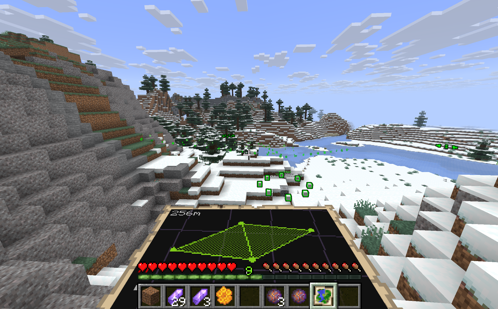
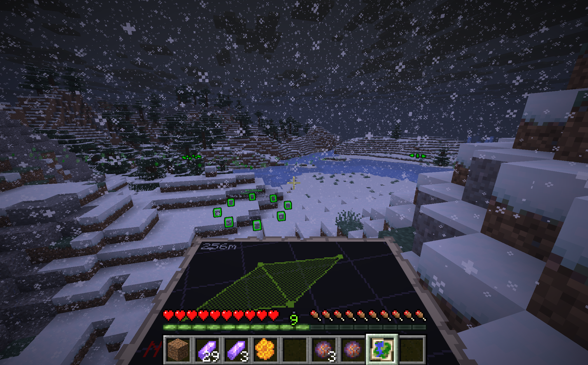

# inigresso
Territorialspiel-Plugin für Spigot 26.3: zwei Fraktionen erobern von Spielern vorgeschlagene
Portale, verbinden sie mit Links und spannen Felder auf.

| Klares Wetter | Im Schnee |
|---|---|
|  |  |

*Portal „Westhügel“ der Lumen mit acht leuchtenden Resonatoren; unten der Scanner mit zwei
Lumen-Feldern. Echte Screenshots von meck mc2.*

- [rules.md](rules.md) – Spielregeln
- [architecture.md](architecture.md) – Aufbau des Plugins
- [implement.md](implement.md) – Umsetzungsplan und Stand
- [ADMIN_GUIDE.md](ADMIN_GUIDE.md) – Installation, Konfiguration, Admin-Befehle, Sicherung
- Spieleranleitung: <https://cndrbrbr.github.io/inigresso/>

Bauen:

```
docker run --rm -v $PWD:/src -v /root/.m2:/root/.m2 -w /src \
  maven:3.9-eclipse-temurin-25 mvn -q -B package
```
