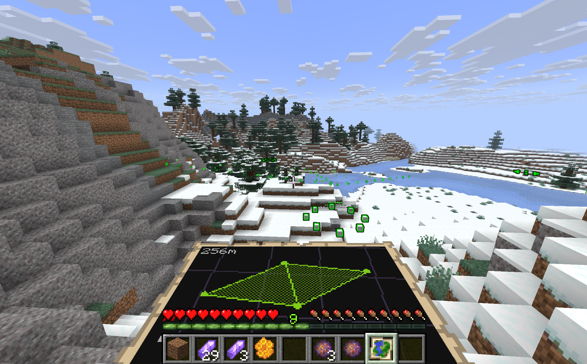
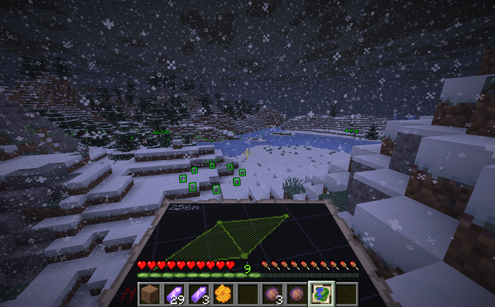

# Inigresso – Spieleranleitung

Inigresso ist ein Territorialspiel in Minecraft. Drei Fraktionen erobern Portale, verbinden
sie mit Links und spannen damit Felder auf. Wer im Wochenschnitt den meisten Einfluss hat,
gewinnt den Zyklus. Das Spiel läuft dauerhaft weiter; jede Woche beginnt eine neue Wertung.

Diese Anleitung erklärt das Spiel für Spieler. Alle genauen Zahlen und Sonderfälle stehen in
den [Spielregeln](rules.md). Eine bebilderte Fassung gibt es unter
<https://cndrbrbr.github.io/inigresso/>.

| Klares Wetter | Im Schnee |
|---|---|
|  |  |

*Portal „Westhügel“ der Lumen mit acht leuchtenden Resonatoren, unten der Scanner.*

---

## Inhalt

1. [Erste Schritte](#1-erste-schritte)
2. [Portale finden: Scanner und Navigation](#2-portale-finden-scanner-und-navigation)
3. [Hacken: Ausrüstung und XP sammeln](#3-hacken-ausrüstung-und-xp-sammeln)
4. [Portale erobern und ausbauen](#4-portale-erobern-und-ausbauen)
5. [Angreifen mit Bursts](#5-angreifen-mit-bursts)
6. [Portale pflegen: XP und Aufladen](#6-portale-pflegen-xp-und-aufladen)
7. [Links ziehen](#7-links-ziehen)
8. [Felder und Wertung](#8-felder-und-wertung)
9. [Spielerstufe und Aktionspunkte](#9-spielerstufe-und-aktionspunkte)
10. [Was du auf dem Bildschirm siehst](#10-was-du-auf-dem-bildschirm-siehst)
11. [Eigene Portale vorschlagen](#11-eigene-portale-vorschlagen)
12. [Befehle](#12-befehle)
13. [Tipps für den Anfang](#13-tipps-für-den-anfang)
14. [Häufige Fragen](#14-häufige-fragen)

---

## 1. Erste Schritte

**Fraktion wählen.** Bevor du mitspielen kannst, entscheidest du dich für eine Fraktion:

| Fraktion | Farbe | Befehl |
|---|---|---|
| **Lumen** | grün | `/ig fraktion lumen` |
| **Wächter** | blau | `/ig fraktion waechter` |
| **Clip** | rot | `/ig fraktion clip` |

- Die Wahl ist **dauerhaft**. Wechseln kann nur ein Admin, und dabei gehen deine
  Spielgegenstände verloren.
- `/ig fraktion` ohne Angabe zeigt, wie viele Spieler jede Fraktion hat. Ist eine deutlich
  größer, bekommst du einen Hinweis – entscheiden darfst du trotzdem frei.
- Nach der Wahl bekommst du einen **Scanner** (eine Karte mit allen Portalen).

**Woran du deine Fraktion erkennst:** Dein Name steht in Fraktionsfarbe mit `[Lumen]`, `[Wächter]` oder
`[Clip]` davor über deinem Kopf, dazu deine Spielerstufe (z. B. `[Lumen] Anna · L2`).
Beim Einloggen steht die Fraktion im Chat, außerdem oben rechts auf dem Scanner und bei
`/ig info`.

**Der Spielablauf in Kurzform:**

1. Portal suchen (Scanner, `/ig karte`).
2. Portal hacken → Resonatoren, Bursts, Schlüssel und XP.
3. Resonatoren auf neutrale oder eigene Portale setzen → Portal gehört deiner Fraktion.
4. Mit Schlüsseln Links zwischen eigenen Portalen ziehen.
5. Drei verlinkte Portale bilden ein Feld → Einfluss für deine Fraktion.
6. Portale mit XP aufladen, damit sie nicht verfallen; gegnerische mit Bursts angreifen.

---

## 2. Portale finden: Scanner und Navigation

**Portale** sind Leitsteine (Lodestones), meist an Bauwerken oder in der Landschaft. Über dem
Kern schwebt eine Anzeige mit Name, Nummer, Fraktion, Stufe und Energie. Der Leitstein leuchtet
in der Farbe seiner Fraktion – grün, blau oder grau (neutral) –, auch durch Wände hindurch.

### Scanner

Der Scanner ist eine Karte, die das Spiel selbst zeichnet:

- **alle** Portale als Punkte (grün, blau, neutral grau) mit ihrer **Nummer** daneben,
- Links als Linien, Felder als gerasterte Flächen in Fraktionsfarbe,
- du selbst als Pfeil in der Mitte.

Bedienung:

| Was | Wie |
|---|---|
| Zoom wechseln (128, 256, 512, 1024 Blöcke) | Scanner in der Hand, **Schleichen + Rechtsklick** (nicht auf einen Portalkern) – oder `/ig scanner zoom <Blöcke>` |
| Norden fest oben | `/ig scanner norden` (zurück: `/ig scanner drehen`) |
| Beim Laufen sehen | Scanner in die Nebenhand nehmen (Taste **F**) |
| Neuen Scanner holen | `/ig scanner` |

Standardmäßig ist oben, wohin du schaust; ein rotes **N** am Rand zeigt Norden. Beim Tod
behältst du den Scanner.

### Navigation

- `/ig karte` listet die zehn nächsten Portale mit Entfernung, Richtung, Fraktion und Stufe.
  Mit `/ig karte <Radius>` suchst du weiter.
- **Klick** auf eine Zeile – oder `/ig ziel <Name>` bzw. `/ig ziel #12` – macht das Portal
  zum Ziel. Über der Hotbar zeigt ein Pfeil die Richtung und die Entfernung, auf dem Scanner
  ist das Ziel markiert.
- Ab 5 Blöcken bist du angekommen. `/ig ziel aus` beendet die Navigation.
- `/ig portal` zeigt alles über das nächste Portal im Umkreis von 16 Blöcken: Resonatoren,
  Energie, Reichweite und Links.

**Webkarte:** Auf <https://karte-inigresso.meckminecraft.de/> siehst du alle Portale, Links
und Felder auch im Browser, dazu den aktuellen Spielstand.

---

## 3. Hacken: Ausrüstung und XP sammeln

**Rechtsklick auf einen Portalkern** – ohne Resonator oder Burst in der Hand – ist ein
**Hack**. Das geht an jedem Portal, egal welcher Fraktion es gehört.

Ein Hack bringt:

- **2–4 Gegenstände** (am gegnerischen Portal 3–5): Resonatoren oder Bursts, ungefähr in der
  Stufe des Portals (eine darunter bis eine darüber).
- mit **50 % Chance einen Schlüssel** des Portals.
- **XP**: 10 × Portalstufe (neutrale Portale zählen als Stufe 1), am gegnerischen Portal
  das 1,5-Fache.
- **Aktionspunkte (AP)**: 100, am gegnerischen Portal 150.

Grenzen pro Spieler und Portal: **5 Minuten** Abklingzeit zwischen zwei Hacks und höchstens
**4 Hacks in 4 Stunden**. Wenn ein Portal „sich erholen muss“, zieh einfach zum nächsten.

### Deine Ausrüstung

| Gegenstand | Sieht aus wie | Wozu |
|---|---|---|
| **Resonator** L1–L8 | Amethystscherbe | Portal erobern und ausbauen |
| **Burst** L1–L8 | Feuerkugel | gegnerische Resonatoren zerstören |
| **Schlüssel** | Trial Key, „Schlüssel #12: Name“ | Link **zu** diesem Portal ziehen; Portal aus der Ferne aufladen |

- Spielgegenstände liegen im normalen Inventar, gehen **beim Tod nicht verloren** und lassen
  sich nicht craften oder im Amboss verändern. Übersicht: `/ig inventar`.
- Höchstens 500 Spielgegenstände im Inventar. Was darüber hinausgeht, verfällt beim Hacken.
  In Truhen gelagerte Gegenstände zählen nicht mit.
- Gegenstände über deiner Spielerstufe darfst du sammeln, aber erst mit höherer Stufe
  benutzen.

---

## 4. Portale erobern und ausbauen

**Resonator in die Hand, Rechtsklick auf den Kern.** Er schwebt dann auf einem der acht Plätze
im Ring um den Kern.

- **Neutrales Portal** (keine Resonatoren): Der erste Resonator erobert es für deine
  Fraktion. Das zählt als **Eroberung** im Scoreboard.
- **Eigenes Portal:** Weitere Resonatoren füllen freie Plätze. Sind alle acht belegt, ersetzt
  ein stärkerer Resonator den schwächsten (**Aufrüsten**).
- **Gegnerisches Portal:** Dort kannst du keine Resonatoren setzen, sondern musst erst alle
  gegnerischen mit Bursts zerstören.

**Portalstufe** = Durchschnitt der acht Plätze (leere zählen 0), abgerundet, mindestens 1.
Höhere Stufen bringen bessere Beute, mehr XP und größere Link-Reichweite.

Damit ein Portal stark wird, muss die Fraktion zusammenarbeiten. Jeder Spieler darf auf einem
Portal nur begrenzt viele hohe Resonatoren setzen:

| Resonatorstufe | 8 | 7 | 6 | 5 | 4 | 1–3 |
|---|---|---|---|---|---|---|
| pro Spieler und Portal | 1 | 1 | 2 | 2 | 4 | 8 |

Ein Portal der Stufe 8 braucht also acht verschiedene Spieler.

Um den Kern herum (4 Blöcke) kann niemand bauen oder abbauen, und Explosionen wirken dort nicht.

---

## 5. Angreifen mit Bursts

- **Burst in die Hand, Rechtsklick** (in die Luft oder auf einen Block). Der Burst wird
  verbraucht und schadet allen **gegnerischen** Resonatoren in der Nähe.
- Reichweite: 2 + 2 × Stufe Blöcke (L1: 4, L4: 10, L8: 18). Der Schaden ist direkt am
  Resonator am größten und nimmt zum Rand hin ab. **Geh nah an die Resonatoren heran.**
- Gemessen wird bis 6 Blöcke Höhenunterschied zum Portalkern.
- Ein Resonator mit 0 Energie verschwindet. Fällt der letzte, wird das Portal **neutral** –
  dann kann es jeder erobern, und alle Links und Felder daran brechen weg.

Resonator-Energie je Stufe:

| Stufe | 1 | 2 | 3 | 4 | 5 | 6 | 7 | 8 |
|---|---|---|---|---|---|---|---|---|
| Energie | 1000 | 1500 | 2000 | 2500 | 3000 | 4000 | 5000 | 6000 |

---

## 6. Portale pflegen: XP und Aufladen

Jeden Tag um **03:00 Uhr** (Serverzeit) verlieren alle Resonatoren **15 %** ihrer
Höchstenergie. Ein Portal, um das sich niemand kümmert, ist nach etwa einer Woche wieder
neutral.

### Aufladen

- Am Kern eines **eigenen** Portals: **Schleichen + Rechtsklick**.
- Aus der Ferne: `/ig aufladen <Portal>` – dafür brauchst du einen Schlüssel des Portals; er
  wird **nicht** verbraucht.
- Kosten: **1 XP = 10 Energie**, höchstens 1000 Energie (100 XP) pro Vorgang. Die schwächsten
  Resonatoren werden zuerst gefüllt.
- Der Chat meldet, wie viel Energie und wie viele XP es waren.

### Was sind XP?

XP sind die **normalen Minecraft-Erfahrungspunkte** – die grüne Leiste über der Hotbar.

**Woher:**

- **Hacken** – die wichtigste Quelle (10 bis 120 XP pro Hack, siehe Abschnitt 3).
- wie in Minecraft üblich: Erze abbauen (Kohle, Redstone, Lapis, Diamant, Smaragd,
  Netherquarz), Erze im Ofen schmelzen, Tiere züchten, angeln, mit Dorfbewohnern handeln.
  Monster gibt es nur, wenn der Server nicht auf „friedlich“ steht.

**Wo sehe ich meine XP?** Die Zahl über der grünen Leiste ist dein **Minecraft-Level**, nicht
die Punktzahl. Die genaue Punktzahl und wie viel Energie sie ergibt, zeigt **`/ig info`**.

**Wie viel brauche ich?** Ein Portal mit acht L1-Resonatoren verliert täglich 1 200 Energie
(120 XP), ein volles L8-Portal 7 200 Energie (720 XP). Teilt euch die Pflege in der Fraktion
auf.

> **Nicht verwechseln:** Das **L2** hinter deinem Namen ist deine **Inigresso-Spielerstufe**
> aus Aktionspunkten (Abschnitt 9). Sie sinkt nie. Das **Minecraft-Level** über der grünen
> Leiste sind deine XP – die gibst du beim Aufladen aus.

Beim Tod gelten die normalen Minecraft-Regeln: XP gehen größtenteils verloren. Lade also lieber
auf, bevor du dich in Gefahr begibst.

---

## 7. Links ziehen

Ein **Link** ist eine gerade Verbindung zwischen zwei Portalen deiner Fraktion. Du stehst an
Portal A und ziehst einen Link zu Portal B:

```
/ig link <B>        (Name oder #Nummer)
```

Voraussetzungen:

- Du stehst höchstens **6 Blöcke** vom Kern von A entfernt.
- A gehört deiner Fraktion und hat **alle 8 Resonatoren**.
- Du hast einen **Schlüssel von B** – er wird dabei verbraucht.
- B gehört ebenfalls deiner Fraktion.
- B liegt in **Reichweite** von A: 160 × Portalstufe² Blöcke, höchstens 2000.

| Portalstufe von A | 1 | 2 | 3 | ab 4 |
|---|---|---|---|---|
| Reichweite (Blöcke) | 160 | 640 | 1440 | 2000 |

Schon ein Portal der Stufe 1 erreicht seine Nachbarportale (die meisten liegen etwa 100 Blöcke
auseinander). Ist das Ziel zu weit weg, sagt dir die Meldung, welche Portalstufe nötig wäre.
`/ig portal` zeigt die Reichweite des Portals, an dem du stehst.

- Der Link darf **keinen anderen Link kreuzen** – egal welcher Fraktion (von oben gesehen).
- A darf nicht unter einem gegnerischen Feld liegen.
- Von einem Portal gehen höchstens 8 Links aus; ankommen dürfen beliebig viele.

Links erscheinen als Partikelstrahl in Fraktionsfarbe. Ein Link verschwindet, sobald eines
seiner beiden Portale neutral wird.

---

## 8. Felder und Wertung

**Drei Portale, die paarweise verlinkt sind, bilden automatisch ein Feld.** Das Dreieck
schimmert in Fraktionsfarbe; wer darunter steht, sieht oben eine Bossbar. Neue Felder werden
allen im Chat gemeldet.

- **Einfluss** eines Feldes = Fläche in Blöcken² ÷ 100, aufgerundet. Große Dreiecke lohnen sich.
- Überlappende Felder deiner Fraktion zählen **jeweils voll** – Schichten lohnen sich also.
- Ein Feld zerfällt, sobald einer seiner drei Links wegfällt.

**Wertung:**

- Jede volle Stunde wird der Gesamteinfluss aller drei Fraktionen gemessen.
- Ein **Zyklus** dauert eine Woche (Montag bis Sonntag). Gewinner ist die Fraktion mit dem
  **höchsten Durchschnitt** aller Messungen. Wer also lange Felder hält, gewinnt – nicht wer
  nur kurz vor Schluss eins aufspannt.
- Portale, Links und Felder bleiben über das Zyklusende hinaus bestehen.
- `/ig stand` zeigt den aktuellen Stand, `/ig zyklus alt` die früheren Ergebnisse.

---

## 9. Spielerstufe und Aktionspunkte

Für fast alles im Spiel bekommst du **Aktionspunkte (AP)**. Mit genug AP steigst du eine
**Spielerstufe** auf. Deine Stufe bestimmt, welche Resonatoren und Bursts du benutzen darfst.

| Aktion | AP |
|---|---|
| Resonator setzen | 125 |
| Resonator aufrüsten | 65 |
| Portal erobern (erster Resonator) | 500 |
| Gegnerischen Resonator zerstören | 75 |
| Link ziehen | 313 |
| Feld erzeugen | 1250 |
| Hacken (eigenes/neutrales / gegnerisches Portal) | 100 / 150 |
| Portal aufladen | 10 |
| Eigener Portalvorschlag angenommen | 1000 |

| Stufe | 1 | 2 | 3 | 4 | 5 | 6 | 7 | 8 |
|---|---|---|---|---|---|---|---|---|
| AP | 0 | 2 500 | 20 000 | 70 000 | 150 000 | 300 000 | 600 000 | 1 200 000 |

`/ig info` zeigt Stufe, AP und wie viele AP bis zur nächsten Stufe fehlen.

---

## 10. Was du auf dem Bildschirm siehst

- **Scoreboard (rechts):** Restzeit des Zyklus und für jede Fraktion Fläche, Einfluss jetzt
  und im Durchschnitt (Ø – der entscheidet), gehaltene Portale und Eroberungen im Zyklus.
  Die führende Fraktion hat einen ★. Unten stehen die drei Top-Eroberer.
  Ausblenden: `/ig scoreboard aus`, wieder an: `/ig scoreboard an`.
- **Namensschild und Tabliste:** Fraktion und Spielerstufe aller Spieler.
- **Bossbar (oben):** erscheint, wenn du unter einem Feld stehst – mit Einfluss und Zahl der
  Schichten.
- **Actionbar (über der Hotbar):** Pfeil und Entfernung zum Navigationsziel.
- **Portalanzeige:** Name, Nummer, Fraktion, Stufe, Resonatoren und Energie in Prozent.

---

## 11. Eigene Portale vorschlagen

Ab **Spielerstufe 2** kannst du neue Portale vorschlagen. Stell dich genau dorthin, wo der
Kern stehen soll – am besten an ein schönes Bauwerk –, und gib ein:

```
/ig vorschlagen <Name>
```

- Name: 3–32 Zeichen, nicht nur Ziffern, noch nicht vergeben.
- Mindestens **48 Blöcke** Abstand zu allen anderen Portalen und Vorschlägen.
- Höchstens 3 offene Vorschläge gleichzeitig.
- Ein Admin prüft den Vorschlag. Die Entscheidung bekommst du als Nachricht, auch wenn du
  gerade nicht online bist. Wird er angenommen, gibt es 1000 AP.

---

## 12. Befehle

| Befehl | Wofür |
|---|---|
| `/ig hilfe` | Alle Befehle |
| `/ig fraktion lumen` / `waechter` / `clip` | Fraktion wählen (einmalig) |
| `/ig info` | Fraktion, Stufe, AP, Spielgegenstände, **XP** |
| `/ig portal` | Infos zum nächsten Portal |
| `/ig inventar` | Deine Spielgegenstände |
| `/ig karte [Radius]` | Nächste Portale, Klick setzt das Ziel |
| `/ig ziel <Portal\|#Nr>` / `/ig ziel aus` | Navigation starten / beenden |
| `/ig scanner` | Neuer Scanner; `zoom <Blöcke>`, `norden`, `drehen` |
| `/ig link <Portal>` | Link vom aktuellen Portal ziehen |
| `/ig aufladen <Portal>` | Eigenes Portal per Schlüssel mit XP aufladen |
| `/ig scoreboard an\|aus` | Scoreboard ein-/ausblenden |
| `/ig stand` | Einfluss und laufender Zyklus |
| `/ig zyklus alt` | Frühere Zyklusergebnisse |
| `/ig vorschlagen <Name>` | Portal vorschlagen (ab Stufe 2) |

Portale kannst du in Befehlen per Name oder per Nummer (`#12`) angeben. Die Nummern stehen auf
dem Scanner und in `/ig karte`.

**Maus und Tastatur am Portal:**

| In der Hand | Rechtsklick auf den Kern | Schleichen + Rechtsklick auf den Kern |
|---|---|---|
| nichts / anderes | hacken | aufladen (eigenes Portal) |
| Resonator | Resonator setzen / aufrüsten | – |
| Burst | Burst zünden | – |
| Scanner | hacken | aufladen; abseits des Kerns: Zoom |

---

## 13. Tipps für den Anfang

1. **Viel hacken.** Zieh von Portal zu Portal, solange die Abklingzeit läuft. Das bringt
   Ausrüstung, Schlüssel, XP und AP – Stufe 2 hast du schnell.
2. **Neutrale Portale erobern.** Jede Eroberung bringt 500 AP und zählt im Scoreboard.
3. **Zusammen ausbauen.** Volle acht Resonatoren braucht jedes Portal, von dem ein Link
   ausgehen soll. Hohe Stufen schafft ihr nur gemeinsam.
4. **Schlüssel sammeln.** Ohne Schlüssel kein Link – heb Schlüssel von Portalen auf, die du
   verbinden willst.
5. **Dreiecke planen.** Schau auf dem Scanner, welche Links ihr ziehen könnt, ohne andere zu
   kreuzen. Lieber erst große Außendreiecke, dann innen Schichten.
6. **Pflegen.** Lade die Portale auf, an denen eure Felder hängen – fällt eins, ist das
   ganze Netz weg.
7. **Gezielt angreifen.** Ein einziges gegnerisches Portal neutral zu machen, kann mehrere
   gegnerische Felder auf einmal zerstören.

---

## 14. Häufige Fragen

**Ich habe meinen Scanner verloren.** `/ig scanner` gibt dir einen neuen.

**Ich kann einen Resonator nicht setzen.** Entweder ist seine Stufe höher als deine
Spielerstufe, du hast auf diesem Portal schon die erlaubte Zahl dieser Stufe gesetzt, oder
das Portal gehört der anderen Fraktion.

**Hacken klappt nicht.** Das Portal braucht noch etwas Zeit (5 Minuten), oder du hast es in
den letzten 4 Stunden schon 4-mal gehackt. Die Meldung sagt, wie lange du warten musst.

**„Du hast keine Erfahrungspunkte zum Aufladen.“** Sammle XP, am einfachsten durch Hacken.
`/ig info` zeigt, wie viele du hast.

**Mein Link geht nicht.** Prüfe: 8 Resonatoren an deinem Portal? Schlüssel des Zielportals
dabei? Ziel in Reichweite und in deiner Fraktion? Kreuzt der Link einen anderen? Die
Fehlermeldung nennt den Grund.

**Verliere ich beim Tod etwas?** Spielgegenstände und Scanner behältst du. XP gehen nach den
normalen Minecraft-Regeln verloren.

**Kann ich die Fraktion wechseln?** Nur über einen Admin, und dabei verfallen alle deine
Spielgegenstände.
