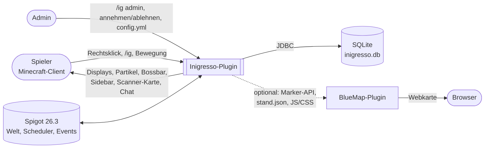

# 3. Kontextabgrenzung

| Partner | Richtung | Inhalt |
|---|---|---|
| Spieler | ein | Rechtsklick auf Portalkern (setzen, aufrüsten, hacken, aufladen), Bursts, `/ig …`, Bewegung (Bossbar, Zielpfeil, Scanner) |
| Spieler | aus | Leitstein, `TextDisplay`/`BlockDisplay`, Partikel, Bossbar, Sidebar, Tabliste, Scanner-Karte, Chat |
| Admin | ein | `/ig admin …`, Vorschläge, `/ig reload`, `config.yml` |
| Spigot | beide | Events (Interact, Chunk-Load, Join/Quit, Tod/Respawn, Block-/Explosionsschutz), Scheduler, Scoreboard, Karten-API |
| SQLite | aus/ein | Gesamter Spielstand; gelesen nur beim Start |
| BlueMap (optional, `softdepend`) | aus | Markersatz „Inigresso“ (Portale, Links, Felder), `assets/inigresso/stand.json` alle 20 s, `inigresso-stand.js/.css` im Webroot |
| Browser | – | Kein direkter Kontakt; nur über BlueMap |

Nicht im Umfang: eigener Webserver, Discord, mehrere Server (Bungee/Velocity).
