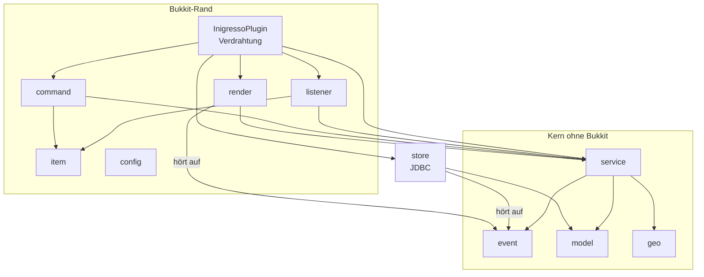

# 5. Bausteinsicht

## 5.1 Ebene 1: Pakete

Basis: `io.github.cndrbrbr.inigresso`. Die Abhängigkeiten zeigen nur nach unten; die drei
unteren Kästen kennen Bukkit nicht.

| Paket | Verantwortung | Bukkit? |
|---|---|---|
| `geo` | `Vec2`, `Segment`, `Triangle`, `Geometry` (Kreuzung, Fläche, Punkt im Dreieck), `Compass` | nein |
| `model` | `Faction`, `Portal`, `Resonator`, `Link`, `Field`, `Proposal`, `PlayerProfile`, `GameItem`, `BlockPos` | nein (`Faction` nutzt nur `ChatColor`) |
| `event` | `GameEvent` (sealed, Records), `GameEventBus` | nein |
| `service` | Spielregeln und Zustand im Speicher, siehe 5.2 | nein |
| `store` | `Database` (Verbindung, Migrationen, Schreibqueue) + ein Repository je Tabellengruppe | nur JDBC |
| `render` | Portalanzeige, Partikel/Bossbar, Sidebar, Teams/Tabliste, Scanner-Bild, Navigation, Webkarte | ja (Bild- und Markerinhalt in eigenen Bukkit-freien Klassen) |
| `listener` | Interaktion am Kern, Schutz, Join/Quit, Item-Schutz, Scanner, automatische Portale | ja |
| `command` | `/ig` mit Unterbefehlen und Tab-Completion | ja |
| `item` | markierte Items erzeugen/erkennen (PDC), Inventar zählen, Scanner-Item, XP | ja |
| `config` | `InigressoConfig`: typisiert aus `config.yml`, bei `/ig reload` neu | lesend |

## 5.2 Ebene 2: Services

| Service | Verantwortung | Regeln |
|---|---|---|
| `ProfileService` | Spielerprofile im Speicher, Join anlegen/aktualisieren | – |
| `FactionService` | Wahl, Admin-Wechsel/Entfernen, Größenhinweis | §1 |
| `PlayerProgressService` | AP vergeben, Stufe berechnen, `LevelUp` | §9 |
| `ProposalService` | Vorschlag prüfen, annehmen/ablehnen, Portal anlegen | §2.1 |
| `PortalService` | Portale, Resonatoren setzen/aufrüsten, Portalstufe, Neutralisieren, Index nach Position | §2, §3 |
| `HackService` | Abklingzeit, Loot, Schlüsselchance, XP | §4, §5.1 |
| `CombatService` | Burst-Schaden, Zerstörung | §5 |
| `EnergyService` | Aufladen, täglicher Verfall inkl. Nachholen | §5 |
| `LinkService` | Linkbedingungen, Reichweite, Kreuzung, **und Felder** (größtes Dreieck je Seite, Abbau), Einfluss | §6, §7 |
| `ScoreService` | Messpunkte, Zyklusgrenzen, Ergebnis, Nachholen | §8 |
| `CaptureStats` | Eroberungen je Fraktion/Spieler im laufenden Zyklus | §10.1 |
| `AutoPortalPlanner` | Zielpunkt je Rasterzelle (deterministisch versetzt) | §2.5 |

Einen eigenen `FieldService` gibt es nicht (anders als im ersten Entwurf): Felder entstehen
und vergehen nur mit Links, deshalb verwaltet `LinkService` beide.

## 5.3 Ebene 2: `store`

| Klasse | Tabellen |
|---|---|
| `Database` | `schema_version`; Migrationen `resources/db/V1…V7` |
| `PortalRepository` | `portal`, `resonator`, `proposal` |
| `PlayerRepository` | `player` |
| `LinkRepository` | `link`, `field` |
| `HackRepository` | `hack_log` |
| `ScoreRepository` | `measurement`, `cycle` |
| `CaptureRepository` | `capture_log` |
| `MessageRepository` | `message` (Nachrichten an Offline-Spieler) |
| `AuditRepository` | `audit` |
| `AutoCellRepository` | `auto_cell` (schon geprüfte Rasterzellen) |
| `StateRepository` | `state` (Schlüssel/Wert: `last_decay`, `scanner_map`, `sidebar_hidden`, Zyklusstart …) |

`player_item` existiert im Schema, wird aber nicht benutzt
([ADR-0004](adr/0004-spielgegenstaende-als-markierte-items.md)).

## 5.4 Ebene 2: `render`

| Klasse | Zeigt | Bukkit-freier Teil |
|---|---|---|
| `PortalRenderer` | Leitstein, `TextDisplay`, Resonatoren als `BlockDisplay`, Leuchten | – |
| `NetworkRenderer` | Link-Partikel, Feld-Partikel, Bossbar im Feld | – |
| `Sidebar`, `FactionTeams` | Scoreboard rechts, Team je Spieler (Präfix, Stufe), Tabliste | `Sidebar.Data` |
| `ScannerRenderer` | Karten-Item (eine gemeinsame Karten-ID, kontextbezogen je Spieler) | `ScannerImage`, `ScannerProjection`, `ScannerLabels` |
| `Navigator` | Zielpfeil in der Actionbar | – |
| `WebMapMarkers` | BlueMap-Marker, `stand.json`, JS/CSS | `WebMapContent` |
