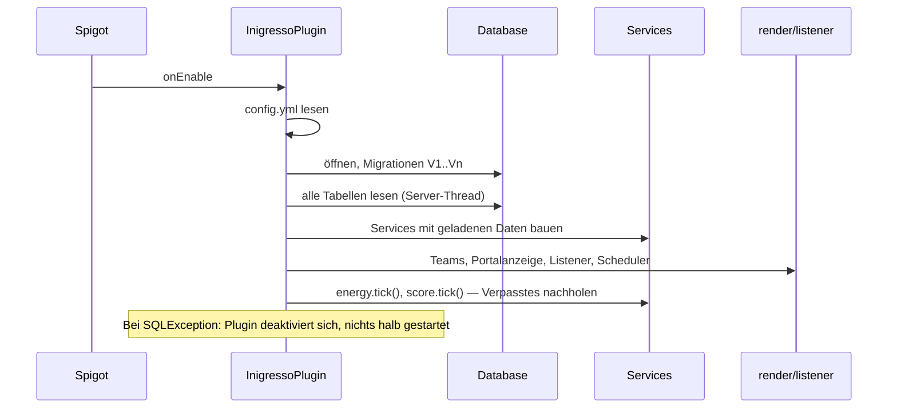
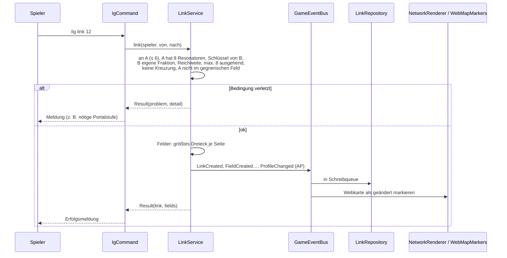

# 6. Laufzeitsicht

Drei Abläufe, an denen man das Zusammenspiel versteht.

## 6.1 Start des Plugins

Reihenfolge: Konfiguration → Datenbank → Services → Anzeige → Listener/Befehle. Nach dem Start
wird nicht mehr aus der DB gelesen.

## 6.2 Link ziehen (`/ig link <ziel>`)

Partikel brauchen kein Ereignis: `NetworkRenderer` liest alle 10 Ticks den aktuellen Stand.

## 6.3 Zyklus nach Ausfall nachholen

1. Jede Minute (und einmal beim Start) ruft der Scheduler `ScoreService.tick()`.
2. `tick()` vergleicht die Uhr mit dem gespeicherten Zyklusstart. Ist ein oder mehr Zyklusende
   vorbei, wird jeder verpasste Zyklus aus den vorhandenen Messpunkten abgeschlossen,
   gespeichert und angekündigt.
3. Fehlende Messpunkte werden **nicht** erfunden; ein Zyklus ohne Messpunkte ist unentschieden.
4. Hat sich die Zyklus-Konfiguration geändert, wird der laufende Zyklus einmal verkürzt, damit
   er wieder auf `start-day` passt.

`EnergyService.tick()` macht dasselbe für den täglichen Verfall (`state.last_decay`).
