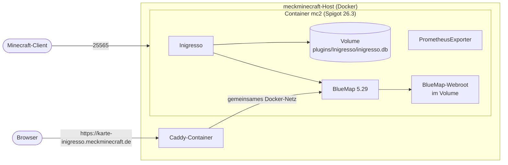

# 7. Verteilungssicht

## 7.1 Allgemein

Eine Jar `inigresso-<version>.jar` in `plugins/`. Beim ersten Start entstehen
`plugins/Inigresso/config.yml` und `plugins/Inigresso/inigresso.db`. Optional BlueMap auf
demselben Server. Installation, Update und Sicherung: [ADMIN_GUIDE.md](../ADMIN_GUIDE.md).

## 7.2 Produktiv: meckminecraft, Server mc2

| Element | Wo | Bemerkung |
|---|---|---|
| Jar | `plugins/` im mc2-Volume | Von Hand gelegt, nicht über den Plugin-Katalog; alte Jars nach `plugin-backup/` |
| Datenbank | `plugins/Inigresso/inigresso.db` im Volume | Kein `sqlite3` auf dem Host → Python-`sqlite3` |
| Neustart | `docker exec mc2 /mc-restart.sh` | Nur nach ausdrücklichem OK, wenn Spieler online sind |
| Konsole | RCON | Kein `rcon-cli` im Container |
| Webkarte | Caddy-Block `karte-inigresso` → BlueMap | BlueMap-Pfade auf einen beschreibbaren Ordner umgestellt (Arbeitsverzeichnis nicht beschreibbar) |
| Logs | `/server/logs/latest.log` im Container | – |

## 7.3 Bau und Test

| Schritt | Wie |
|---|---|
| Bauen + Unit-Tests | `docker run … maven:3.9-eclipse-temurin-25 mvn -q -B package` (siehe README) |
| Server-Test | Wegwerf-Spigot 26.3 mit Konsole per Pipe; Chunks per `forceload` (26.x hat keine Spawn-Chunks) |
| Scanner-Vorschau | Bukkit-freies `ScannerImage` mit echten DB-Daten als PNG rendern |
| Lasttest | [`tools/perf`](../tools/perf/README.md) |
| Spieleranleitung | `docs/` → GitHub Pages per Workflow `pages.yml` |
